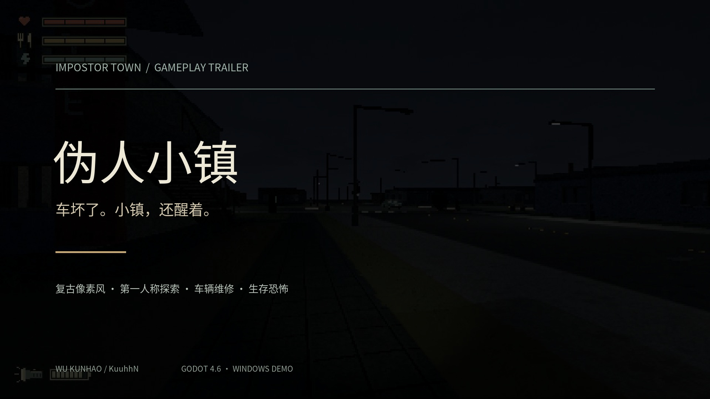
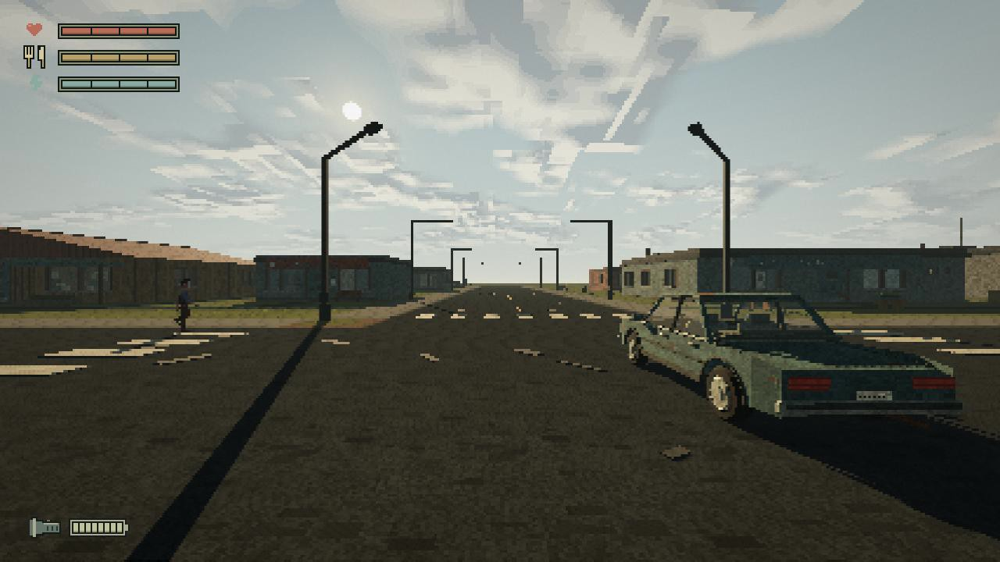

# 伪人小镇 · Impostor Town

**一辆坏车，一座陌生的小镇。探索、修车，赶在危险靠近前离开。**

吴坤昊的个人游戏项目 · Godot 4.6.3 / GDScript · AI 辅助开发 · Windows x64 Demo

[](https://kuuhhn.github.io/ImpostorTown-Showcase/#trailer)

## 面试官快速入口

| 想了解什么 | 直接查看 |
| --- | --- |
| 约 70 秒了解游戏 | **[在线作品展示 / 播放宣传片](https://kuuhhn.github.io/ImpostorTown-Showcase/)** |
| 玩法、系统拆解与个人职责 | **[开发作品集 PDF](docs/ImpostorTown_Portfolio.pdf)** |
| 场景、角色、道具与视觉迭代 | **[美术集 PDF](docs/ImpostorTown_Artbook.pdf)** |
| 本地试玩，无需安装引擎 | **[下载 Windows Demo · 约 102 MiB](https://github.com/KuuhhN/ImpostorTown-Showcase/releases/download/v0.1.0-showcase/ImpostorTown_Demo_Windows_x64_0.1.0_RC1.zip)** |
| 保存宣传片 | [下载 1080p MP4](https://github.com/KuuhhN/ImpostorTown-Showcase/releases/download/v0.1.0-showcase/ImpostorTown_Gameplay_Trailer_1080p.mp4) |

建议阅读顺序：宣传片 → 作品集 → 本地试玩；关注视觉制作时再打开美术集。

## 游戏里做什么

1. **探索小镇**：进入建筑，阅读线索，寻找钥匙、食物、工具和有限物资。
2. **修复车辆**：理解故障并完成八孔轮胎、电池、点火线圈与传动皮带等操作。
3. **面对异常**：与 B 对话，在昼夜变化中观察环境，警惕维尔的窥视、接近与攻击。
4. **驶离小镇**：通过维修检查，从驾驶席触发离场与完成界面。



## 我的职责与 AI 协作

这是个人主导、AI 辅助制作的可玩项目。我负责方向与需求拆解、玩法取舍、视觉参考比较与素材筛选、交互反馈、试玩问题整理及版本验收；通过 Codex 协作推进 GDScript 实现、程序化场景和资源整合。

角色与部分道具采用 AI 辅助图像制作，再进行像素风处理、透明背景整理和引擎接入。作品集中区分设计判断、AI 实现支持和第三方资源，不将全部代码或美术描述为独立手工完成。游戏当前使用预设规则和对白，**没有把 LLM 实时对话包装成已实现功能**。

详见 [设计与实现笔记](docs/DESIGN.md)、[制作与素材说明](docs/PRODUCTION.md)。本仓库是独立的作品展示与发行入口，包含文档、媒体及可玩包；并非完整 Godot 工程源码仓库。

## 如何试玩

下载 ZIP 后**完整解压**，进入 `ImpostorTown_Demo`，双击 `ImpostorTown.exe`。请保持 EXE、PCK 与许可证目录的相对位置。无需安装 Godot。

| 操作 | 按键 |
| --- | --- |
| 移动 / 观察 | WASD / 鼠标 |
| 奔跑 / 下蹲 | Shift / Ctrl |
| 交互 | E |
| 背包与工具箱 / 已获得的地图 | B / M |
| 手电 / 暂停 | F / Esc |
| 维修 | 依照场景提示，部分操作需按住左键或拖动 |
| 离场 | 修复并通过驾驶席检查后按 E；Space 可跳过离场动画 |

平台：Windows x64，Godot Forward+ / Vulkan。已在 NVIDIA RTX 4060 Laptop 环境完成实包验证；尚未建立最低配置基准，不保证所有硬件表现相同。首次启动可能需要准备着色器。

存档：`%APPDATA%/ImpostorTown_Demo_0_1`。普通发行版使用独立存档，默认需要正常探索和收集；“重新开始”会在确认后清空本轮进度。

## 版本与验证边界

当前下载为 **0.1.0 RC1**，ZIP 与本次提供的发布候选文件完全一致。SHA-256：

```text
0ebacc7a3146a63d1d88ff24c8018439eaec095e6dfb78db470da4f242e32c38
```

既有实包自动验证覆盖维修状态、物资/门锁、怪物伤害和离场控制。本次额外从同一 ZIP 启动 EXE，录制了车辆检查和离镇镜头。验证使用独立状态与定位脚本，不能等同于连续人工通关或跨硬件性能认证。详见 [发行说明](docs/RELEASE_NOTES.md)。

本 Demo 包含惊吓与追逐场景。宣传片是实机剪辑，含开发期探索镜头；维修和离场使用本次发行包录制，部分镜头使用专用拍摄存档。未用生成视频冒充玩法。

## 许可

自有代码采用 MIT，自有美术与文本在适用权利范围内采用 CC BY 4.0；字体、纸纹及独立授权音效保留原许可。参见 [许可范围](LICENSE.md)、[第三方声明](THIRD_PARTY_NOTICES.md) 和随试玩包提供的许可证。宣传片配乐为本地数学合成原创氛围音乐。
